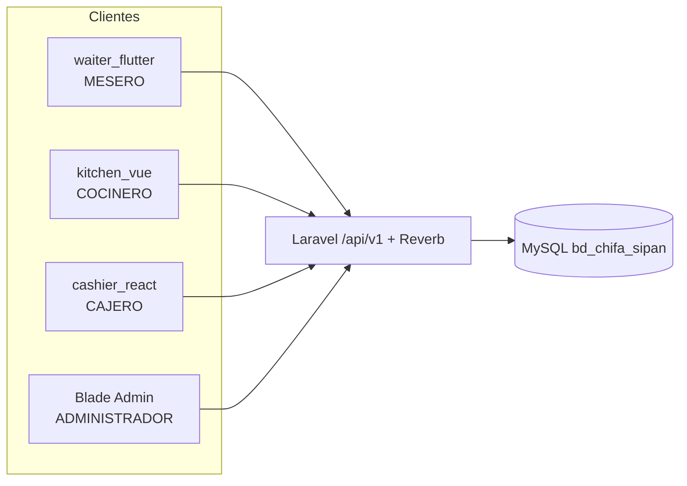

# CHIFA SIPÁN — Plan de Construcción del Sistema Completo y de Cada Interfaz

**Base:** Plan Maestro v3.1 + línea de tablas `BD.sql` (`bd_chifa_sipan`)  
**Entregable:** orden de trabajo, pantallas, contratos API, mapeo a tablas y criterios de aceptación  
**No se escribe código de producto en esta fase:** este documento es la hoja de ruta de implementación.

---

## 0. Principio de construcción

El sistema se construye **de adentro hacia afuera**:

1. Blindar MySQL (remediación + vistas + SPs + triggers).
2. Contratos OpenAPI y tokens de diseño.
3. Backend Laravel modular (única fuente de verdad HTTP).
4. Cuatro clientes desacoplados, cada uno contra `/api/v1` (Admin Blade también usa rutas `web.php` + las mismas Actions).

Ninguna interfaz calcula IGV, saldo, arqueo o precios históricos. Eso vive en MySQL (`vw_*` / `sp_*`) y Laravel solo orquesta.

---

## 1. Diagnóstico de `BD.sql` vs Plan Maestro v3.1

`BD.sql` es el **esqueleto de 29 tablas**. El maestro exige una capa lógica que **aún no está en el SQL**. Sin esa remediación, las pantallas de caja, cocina y meseros no pueden ser correctas.

### 1.1 Tablas presentes (línea base)

| Dominio | Tablas |
| :--- | :--- |
| Identidad | `PERSONA`, `USUARIO`, `CAJERO`, `MESERO`, `ADMINISTRADOR`, `COCINERO`, `REFRESH_TOKEN` |
| Salón | `ZONA`, `MESA` |
| Catálogo | `PRODUCTO`, `CATEGORIA_PLATO`, `PLATO`, `PLATO_VARIANTE`, `BEBIDAS`, `MODIFICADOR`, `PRIORIDAD`, `ESTACION_COCINA` |
| Clientes | `CLIENTE`, `DIRECCION_CLIENTE` |
| Pedidos | `PEDIDO`, `COMANDA`, `DETALLE_COMANDA`, `DETALLE_MODIFICADOR` |
| Facturación | `CAJA_SESION`, `COMPROBANTE`, `PAGO` |
| Control | `AUDITORIA`, `HISTORIAL_ESTADO`, `PARAMETRO_SISTEMA` |

### 1.2 Huecos que bloquean las interfaces (prioridad de migración)

| Hueco | Impacto en UI | Acción |
| :--- | :--- | :--- |
| `PEDIDO` sin `estado`, `version`, `client_request_id`, `id_cliente`, `id_direccion_entrega`, `direccion_snapshot` | Mesero/Caja no saben si está abierto/pagado; delivery sin dirección; doble envío | Migración 3.1 §3.1.2–3.1.5 |
| `DETALLE_COMANDA` sin snapshot de precio/nombre/variante/estación; horas en `TIME` | KDS y cuenta muestran precio vivo (incorrecto); timers rotos | Migración 3.1 §3.1.1 |
| `CLIENTE.id_direccion` NOT NULL | Cliente de salón/boleta simple no puede existir | Nullable |
| Falta `PRODUCTO_ESTACION` | KDS no puede filtrar por estación | Tabla pivote |
| Falta `MOVIMIENTO_CAJA` | Arqueo incompleto | Nueva tabla |
| `COMPROBANTE` sin serie/correlativo/subtotal/IGV/total/estado | POS no emite boleta/factura real | Ampliar |
| `PAGO` sin `payment_request_id` | Doble cobro en red inestable | Unique UUID |
| `REFRESH_TOKEN` sin `family_id` | No hay detección de robo de sesión | Ampliar |
| `MESA.estado` usa `LIBRE` (SQL) vs `DISPONIBLE` (maestro) | Unificar a **`LIBRE`** (valor real de BD) en enums de API y UIs |
| Sin vistas `vw_*`, SPs `sp_*`, triggers `trg_*` | Toda la integridad financiera falta | Scripts SQL en migraciones Laravel |
| Sin tablas WebAuthn | Passkeys Admin/Cajero no implementables | `WEBAUTHN_CREDENTIAL` (migración extra) |

### 1.3 Convención de nombres

- Tablas y columnas: **tal cual `BD.sql`** (`PEDIDO`, `id_pedido`, `DETALLE_COMANDA.id_detalle`).
- El maestro menciona `id_detalle_comanda`: **no se usa**; Eloquent mapea `id_detalle`.
- Estado de mesa: **`LIBRE`**, no `DISPONIBLE`.

---

## 2. Mapa de actores → interfaz → datos



| Rol BD | App | Subdominio prod | Acceso principal |
| :--- | :--- | :--- | :--- |
| `MESERO` | Flutter | n/a (app nativa) | Salón, carta, rondas, seguimiento |
| `COCINERO` + `ESTACION_COCINA` | Vue KDS | `cocina.chifasipan.pe` | Cola por estación |
| `CAJERO` | React POS | `caja.chifasipan.pe` | Sesión de caja, cobro, comprobantes |
| `ADMINISTRADOR` | Blade | `admin.chifasipan.pe` | Catálogo, personal, salón, finanzas, auditoría |

Un `USUARIO` se vincula a `PERSONA` y a **exactamente un** perfil de rol (tablas hijas). El middleware `CheckRoleContext` rechaza uso cruzado (un cajero no entra a KDS).

---

## 3. Fases de entrega (orden obligatorio)

| Fase | Nombre | Resultado usable |
| :--- | :--- | :--- |
| **F0** | Monorepo, Docker, tokens, OpenAPI vacío versionado | Repo navegable; MySQL 8 + Redis + PHP + Reverb locales |
| **F1** | Remediación SQL + vistas + SPs + triggers + usuarios `sipan_app_rw` / `sipan_reporting_ro` | BD lista para invariantes |
| **F2** | Laravel Identity + Auth (JWT corto + refresh cookie / Flutter secure storage) | Login por rol |
| **F3** | Módulos Catalog + Salon + seeders reales | Carta y mapa de mesas leíbles |
| **F4** | Orders + Kitchen + Reverb | Flujo salón → cocina |
| **F5** | Billing (caja, pagos, comprobantes) | Flujo cobrar y cerrar mesa |
| **F6** | Clientes/Delivery/Llevar | Tres canales de venta |
| **F7** | Panel Admin Blade + Reporting | Operación gerencial |
| **F8** | Seguridad anti-phishing (Passkeys, CSP, pinning, family_id) | Endurecimiento |
| **F9** | Pruebas de concurrencia, SLA KDS, arqueo, UAT restaurante | Go-live |

Las interfaces se **esquelizan en F0–F2** (login + shell) y se **llenan de negocio en F3–F7**. No se construye POS completo antes de SPs de pago.

---

## 4. Fase 0 — Esqueleto del repositorio

Crear exactamente la topología del maestro:

```text
chifa-sipan/
├── backend/
├── apps/waiter_flutter/
├── apps/kitchen_vue/
├── apps/cashier_react/
├── packages/design_tokens/
├── contracts/openapi.yaml
├── docs/
├── docker-compose.yml
└── BD.sql                    # línea base; no editar a mano: todo cambio va a migraciones
```

**Design tokens (F0):** colores de estado del maestro (`PENDIENTE` ámbar, `EN_PREPARACION` azul, `LISTO` verde, `ENTREGADO` gris, `CANCELADO` rojo), tipografía táctil (mín. 48dp Flutter / 44px web), moneda `S/`.

**Docker:** MySQL 8.0, Redis, PHP-FPM, Nginx, Laravel Reverb.

---

## 5. Fase 1 — Plan SQL (migraciones, no reescribir `BD.sql`)

Orden de scripts en `backend/database/migrations/`:

1. Snapshot `DETALLE_COMANDA` / `DETALLE_MODIFICADOR`.
2. Estados y `version` en `PEDIDO`; `DATETIME` en hitos de ítem; `client_request_id` en `PEDIDO` y `COMANDA`.
3. Cliente/dirección en `PEDIDO`; `CLIENTE.id_direccion` nullable.
4. `PRODUCTO_ESTACION`.
5. `MOVIMIENTO_CAJA`; ampliar `COMPROBANTE` y `PAGO`.
6. `family_id` en `REFRESH_TOKEN`.
7. `WEBAUTHN_CREDENTIAL` (F8 puede crearla, pero el esquema se reserva aquí).
8. Vistas: `vw_cola_cocina_activa`, `vw_resumen_cuenta_pedido`, `vw_estado_salon_tiempo_real`, `vw_arqueo_sesion_caja`, `vw_auditoria_legible`.
9. SPs: `sp_registrar_ronda_pedido`, `sp_registrar_pago_y_cerrar_cuenta`, `sp_cerrar_sesion_caja`.
10. Triggers + `CHECK` + evento `evt_limpiar_tokens_expirados`.
11. Grants a `sipan_app_rw` y `sipan_reporting_ro`.

Seeders: 1 admin, 1 cajero, 1 mesero, 2 cocineros (Wok / Bebidas), zonas/mesas, categorías chifa, prioridades, `PARAMETRO_SISTEMA` (`IGV`, `razon_social`, `ruc`, `serie_boleta`, `serie_factura`).

---

## 6. Fase 2–7 — Backend: módulos y contratos por pantalla

Anatomía fija por módulo: `Actions / DTOs / Enums / Events / Http / Models / Policies`. Controladores ≤ 15 líneas.

Errores RFC 7807. Códigos HTTP del maestro.

### 6.1 Inventario de endpoints (mínimo viable operativo)

**Identity**

- `POST /api/v1/auth/login`
- `POST /api/v1/auth/refresh`
- `POST /api/v1/auth/logout`
- `GET  /api/v1/auth/me`
- `POST /api/v1/auth/webauthn/options` y `verify` (F8)

**Salon**

- `GET /api/v1/salon/zonas`
- `GET /api/v1/salon/mesas` → `vw_estado_salon_tiempo_real`
- `PATCH /api/v1/salon/mesas/{id}/estado` (solo `LIMPIEZA` → `LIBRE`; el resto lo hacen triggers)

**Catalog**

- `GET /api/v1/catalogo/productos` (cacheable; ETag)
- `GET /api/v1/catalogo/categorias`
- `GET /api/v1/catalogo/productos/{id}` (variantes + modificadores permitidos)

**Orders**

- `POST /api/v1/pedidos` + primera ronda → `sp_registrar_ronda_pedido`
- `POST /api/v1/pedidos/{id}/rondas` (idempotente `client_request_id`)
- `GET  /api/v1/pedidos/{id}`
- `GET  /api/v1/pedidos?estado=&tipo=&id_mesa=`
- `POST /api/v1/detalles/{id}/cancelar`
- `PATCH /api/v1/pedidos/{id}/notas`

**Kitchen**

- `GET /api/v1/cocina/cola?id_estacion=` → `vw_cola_cocina_activa`
- `PATCH /api/v1/cocina/items/{id}/estado` (`PENDIENTE`→`EN_PREPARACION`→`LISTO`; `ENTREGADO` lo confirma el mesero)

**Billing**

- `POST /api/v1/caja/sesiones` (apertura)
- `GET  /api/v1/caja/sesiones/actual` → `vw_arqueo_sesion_caja`
- `POST /api/v1/caja/movimientos`
- `POST /api/v1/caja/sesiones/{id}/cierre` → `sp_cerrar_sesion_caja`
- `GET  /api/v1/cuentas/{id_pedido}` → `vw_resumen_cuenta_pedido`
- `POST /api/v1/comprobantes`
- `POST /api/v1/pagos` → `sp_registrar_pago_y_cerrar_cuenta`

**Broadcast**

- `kitchen.station.{id}` — nueva ronda / cambio de ítem
- `salon.floor` — ocupación de mesas
- `waiter.user.{id}` — ítem `LISTO`
- `cashier.session.{id}` — cuenta actualizada

---

## 7. Plan de cada interfaz (pantalla por pantalla)

Cada pantalla lista: **objetivo**, **datos**, **acciones**, **estados vacíos/error**, **fase**.

---

### 7.1 App Meseros — `apps/waiter_flutter`

Arquitectura: Clean Architecture + Riverpod. Offline: Hive/Isar para catálogo + cola de rondas con UUID v4.

#### M-01 Login y perfil

- **Objetivo:** autenticar `MESERO`; biometría local para reabrir app.
- **Datos:** `USUARIO`, `PERSONA`, `MESERO`, `REFRESH_TOKEN`.
- **Acciones:** login, logout, ver nombre.
- **Error:** 403 si el usuario no es mesero; cuenta bloqueada (`bloqueado_hasta`).
- **Fase:** F2.

#### M-02 Mapa de salón

- **Objetivo:** ver zonas y mesas con color de estado y tiempo de ocupación.
- **Datos:** `vw_estado_salon_tiempo_real` (`MESA`, `ZONA`, pedido activo, mesero, comensales).
- **Acciones:** filtrar zona; tap mesa `LIBRE` → abrir pedido; tap `OCUPADA` → pedido activo; `LIMPIEZA` → marcar `LIBRE` si política lo permite.
- **Tiempo real:** canal `salon.floor`.
- **Fase:** F3.

#### M-03 Apertura de pedido (Salón / Llevar / Delivery)

- **Objetivo:** crear `PEDIDO` con tipo, mesa o datos de entrega, comensales.
- **Datos:** `PEDIDO` (post-migración), `MESA`, `CLIENTE`, `DIRECCION_CLIENTE`.
- **Reglas:** Salón exige `id_mesa`; Llevar/Delivery `id_mesa` null (CHECK SQL).
- **Fase:** F4 (salón), F6 (llevar/delivery).

#### M-04 Carta y búsqueda

- **Objetivo:** elegir productos con variantes y modificadores.
- **Datos:** `PRODUCTO`, `PLATO`, `CATEGORIA_PLATO`, `PLATO_VARIANTE`, `BEBIDAS`, `MODIFICADOR` (cache local).
- **Acciones:** buscar, filtrar categoría, ver tiempo_prep_min.
- **Fase:** F3.

#### M-05 Carrito de ronda (offline-first)

- **Objetivo:** armar `COMANDA` N+1 sin mutar rondas previas.
- **Datos locales:** draft; al enviar: `sp_registrar_ronda_pedido` congela `nombre_snapshot`, `precio_unitario_venta`, `id_estacion_cocina`.
- **Acciones:** cantidad, nota, prioridad, `client_request_id` persistido hasta ACK.
- **Banner offline** obligatorio.
- **Fase:** F4.

#### M-06 Pedido activo / seguimiento

- **Objetivo:** ver ítems por ronda y estado KDS; confirmar `ENTREGADO`.
- **Datos:** `DETALLE_COMANDA.estado_item`, push `LISTO`.
- **Fase:** F4.

#### M-07 Cancelar ítem

- **Objetivo:** pedir anulación con motivo; no borrar fila.
- **Datos:** estado `CANCELADO` + `HISTORIAL_ESTADO` / auditoría.
- **Fase:** F4 (permiso; supervisor en F7 si se exige).

**Navegación Flutter:** Auth → Salon → (Order shell: Menu | Cart | Active).

---

### 7.2 KDS Cocina — `apps/kitchen_vue`

Lectura a 2–3 m, alto contraste, sonido, un `station_id` por sesión (`COCINERO.id_estacion`).

#### K-01 Login estación

- **Datos:** `USUARIO` + `COCINERO` + `ESTACION_COCINA`.
- Fija `station_id`; no permite cambiar estación sin re-login.
- **Fase:** F2.

#### K-02 Header KDS

- Reloj, nombre estación, indicador WS, filtro prioridad, mute audio.
- **Fase:** F4.

#### K-03 Tablero de tickets (`StationBoardView`)

- **Datos:** `vw_cola_cocina_activa` filtrada por estación.
- Cada ticket: nº pedido, tipo (`SALON`/`LLEVAR`/`DELIVERY`), mesa/zona, minutos `TIMESTAMPDIFF`, prioridad color.
- Orden: prioridad + antigüedad.
- **Fase:** F4.

#### K-04 Tarjeta y fila de ítem

- Variante, modificadores resaltados (`GROUP_CONCAT`), nota.
- Acciones táctiles grandes: **Preparar** → **Listo**.
- Timer SLA con umbrales (ámbar/rojo) desde `PRODUCTO.tiempo_prep_min` o parámetro.
- **Fase:** F4.

#### K-05 Modal cancelar ítem

- Motivo + autorización (PIN supervisor en F7; en F4 motivo + rol admin/cocinero según política).
- **Fase:** F4/F7.

**Tiempo real:** Echo + Reverb `kitchen.station.{id}`; reconexión exponencial; al reconectar, `GET cola` full refresh.

---

### 7.3 POS Caja — `apps/cashier_react`

Precisión contable; ningún total se calcula en el cliente salvo vista previa deshabilitada: **solo se muestra `vw_resumen_cuenta_pedido`**.

#### C-01 Login cajero (+ Passkeys en F8)

- Rol `CAJERO`. Si no hay sesión de caja abierta, forzar C-02.
- **Fase:** F2 / F8.

#### C-02 Apertura de caja

- `monto_apertura`, observaciones.
- Una `CAJA_SESION` `ABIERTA` por usuario.
- **Fase:** F5.

#### C-03 Tablero de cuentas abiertas

- Pedidos `ABIERTO` / `EN_PAGO` por tipo Salón / Llevar / Delivery.
- Columnas: mesa o cliente, mesero, tiempo, saldo.
- **Fase:** F5.

#### C-04 Checkout dividido

- Izquierda: `OrderSummaryPanel` (ítems no cancelados, modificadores, IGV, saldo).
- Derecha: cliente, tipo comprobante, pagos.
- **Fase:** F5.

#### C-05 Cliente facturación

- Buscar DNI/RUC; crear `CLIENTE` (dirección opcional salvo factura/delivery).
- Validadores DNI/RUC.
- **Fase:** F5–F6.

#### C-06 Métodos de pago y split

- `EFECTIVO` (vuelto desde SP), `TARJETA`, `YAPE`, `PLIN`, `TRANSFERENCIA` + referencia.
- Cada abono: `payment_request_id` único; UI bloquea doble click.
- **Fase:** F5.

#### C-07 Movimientos de gaveta

- Ingreso/egreso `MOVIMIENTO_CAJA` con motivo.
- **Fase:** F5.

#### C-08 Cierre y arqueo

- Totales de `vw_arqueo_sesion_caja`; monto declarado; diferencia; `sp_cerrar_sesion_caja`.
- Impresión/PDF del cierre (F7 reporting).
- **Fase:** F5.

**Navegación:** SessionGate → OrdersBoard | Checkout | Movements | Close.

---

### 7.4 Panel Admin — Blade + Alpine.js

Layout: `layouts/admin.blade.php` (sidebar, topbar, toasts). Componentes `button`, `table`, `badge`, `modal`, `stat-card`.

| ID | Página | Módulo vistas | Tablas / vistas | Fase |
| :--- | :--- | :--- | :--- | :--- |
| A-01 | Login admin + Passkeys | auth | `USUARIO`, `ADMINISTRADOR` | F2/F8 |
| A-02 | Dashboard | home | KPIs: mesas ocupadas, cola cocina, sesión caja abierta | F7 |
| A-03 | Categorías / platos / bebidas / variantes / modificadores / precios | catalog | `PRODUCTO`… (triggers auditan precio) | F3/F7 |
| A-04 | Prioridades y estaciones; `PRODUCTO_ESTACION` | catalog | enrutamiento KDS | F3 |
| A-05 | Zonas y mesas (capacidad, activa) | salon | `ZONA`, `MESA` | F3 |
| A-06 | Personal: personas, usuarios, asignación MESERO/CAJERO/COCINERO/ADMIN | staff | identidad | F7 |
| A-07 | Clientes y direcciones | staff/crm | `CLIENTE` | F6 |
| A-08 | Parámetros (IGV, series, RUC) | finance | `PARAMETRO_SISTEMA` | F7 |
| A-09 | Sesiones de caja y arqueos | finance | `vw_arqueo_sesion_caja` | F7 |
| A-10 | Comprobantes y pagos | finance | `COMPROBANTE`, `PAGO` | F7 |
| A-11 | Auditoría legible | audit | `vw_auditoria_legible` (solo lectura) | F7 |
| A-12 | Historial de estados | audit | `HISTORIAL_ESTADO` | F7 |
| A-13 | Reportes ventas / productos / estaciones | reports | vistas + Excel/PDF | F7 |
| A-14 | Alertas de seguridad (familia refresh revocada) | audit | `AUDITORIA` | F8 |

Admin **no cobra** y **no toma comandas**; eso es POS y Flutter.

---

## 8. Flujos end-to-end (criterio de integración)

### Flujo A — Cubierto salón (F4+F5)

1. Mesero abre mesa `LIBRE` → trigger `MESA.OCUPADA`, `PEDIDO` `ABIERTO`.
2. Envía ronda → SP snapshot + estaciones → Reverb cocina.
3. Cocinero PENDIENTE → EN_PREPARACION → LISTO → push mesero.
4. Mesero marca ENTREGADO.
5. Cajero cobra (posiblemente split) → SP cierra si saldo 0 → `PAGADO` → mesa `LIBRE` si no hay otro pedido.

### Flujo B — Delivery (F6)

Pedido sin mesa, `id_cliente` + `direccion_snapshot` JSON. KDS muestra tipo DELIVERY. Caja cobra antes o contra entrega según parámetro.

### Flujo C — Concurrencia (prueba Pest)

Dos meseros `POST` la misma mesa: uno `201`, otro `409 ORDER_TABLE_OCCUPIED`.

### Flujo D — Idempotencia

Reintento con mismo `client_request_id` / `payment_request_id`: no duplica ronda ni pago.

---

## 9. Seguridad por interfaz (cuándo)

| Control | Apps | Fase |
| :--- | :--- | :--- |
| Login + bloqueo por intentos | Todas | F2 |
| Cookie `__Host-sipan_refresh` | Blade, Vue, React | F2 |
| FlutterSecureStorage + Keystore/Keychain | Flutter | F2 |
| CSP, `frame-ancestors 'none'`, HSTS | Web | F8 |
| Passkeys Admin y Cajero | Blade, React | F8 |
| Certificate pinning | Flutter | F8 |
| Rotación y `family_id` refresh | Todas | F8 |
| Sanitización notas (sin HTML) | Todas | F4 |

Hasta F8 el sistema es **operable en red interna**; F8 es requisito de exposición a internet.

---

## 10. Pruebas ligadas a cada interfaz

| Capa | Qué prueba | Relacionado a |
| :--- | :--- | :--- |
| MySQL | SP ronda, SP pago, trigger no-delete auditoría, CHECK mesa | F1 |
| Pest | mesa ocupada, refresh robado, snapshot de precio | F4–F8 |
| Flutter | cola offline UUID, no perder ronda | M-05 |
| Vue | timer SLA, orden de cola | K-03 |
| React | bloqueo doble cobro, split no excede saldo | C-06 |
| Blade | CRUD catálogo audita precio | A-03 |

---

## 11. Criterios de “fase terminada”

- **F1:** un SQL de prueba demuestra que no se puede `DELETE` de `AUDITORIA` ni alterar precio de detalle enviado.
- **F4:** un mesero y un KDS reales (navegador + emulador) cierran el ciclo de un chaufa de salón.
- **F5:** un cajero abre caja, cobra mixto Yape+efectivo, cierra con diferencia 0.00.
- **F7:** admin cambia precio de Wantán y el pedido ya enviado **conserva** el precio viejo.
- **F9:** UAT 1 servicio completo (almuerzo) en ambiente staging.

---

## 12. Primera iteración de implementación (siguiente conversación)

Trabajo concreto inmediato, en este orden, sin saltar SQL:

1. Crear estructura de monorepo + `docker-compose.yml`.
2. Importar `BD.sql` en MySQL del compose.
3. Laravel 11 en `backend/` con módulos vacíos y `api_v1.php`.
4. Migraciones de remediación 3.1 sobre la BD existente.
5. Seeders de restaurante.
6. `packages/design_tokens` + shells de las 4 apps (login dummy).
7. OpenAPI: paths de auth + salón + catálogo (contract-first antes de controladores).

Cuando se apruebe este plan, la implementación arranca en el punto 1.
